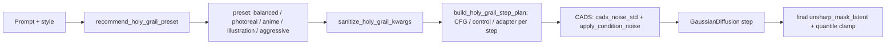

# Holy Grail adaptive sampling (how it fits together)

**Holy Grail** is SDX's name for a **per-step inference policy**: CFG strength, ControlNet scale and adapter scales change across denoise steps instead of staying fixed, with optional CADS condition annealing and a final latent detail pass.

The code is one module, [`diffusion/sampling.py`](../diffusion/sampling.py) (import path `diffusion.sampling`). `GaussianDiffusion.sample_loop` applies it each step; `sample.py` exposes it as `--holy-grail`, `--holy-grail-preset` and the `--holy-grail-*` knobs.

## End-to-end flow



## Design intent

| Idea | Role |
|------|------|
| **Presets + auto** | `--holy-grail-preset auto` picks a knob bundle from prompt keywords; a preset only fills args still at their defaults. |
| **Step plan** | CFG ramps from `cfg_early_ratio` to `cfg_late_ratio` of the base scale; ControlNet front-loads (or ramps up with `--holy-grail-no-frontload-control`); adapters boost late. |
| **CADS** | Gaussian noise on the text conditioning, strongest at the first step and decaying as `(1-p)^power`: more varied compositions at high CFG while late steps stay faithful (Sadat et al., ICLR 2024). |
| **Final latent pass** | `unsharp_mask_latent` (in `diffusion/sampling_utils.py`) lifts fine detail; the quantile clamp clips per-sample outliers without rescaling. |
| **Guard** | Every knob is clamped to a stable range and made consistent before it reaches the loop. |

## CLI starter

```bash
python sample.py --ckpt path/to.pt --prompt "..." --holy-grail \
  --holy-grail-preset auto \
  --holy-grail-cads-strength 0.03 \
  --holy-grail-cfg-early-ratio 0.72 \
  --holy-grail-cfg-late-ratio 1.0 \
  --holy-grail-control-mult 1.1 \
  --holy-grail-unsharp-sigma 0.6 \
  --holy-grail-unsharp-amount 0.18 \
  --holy-grail-clamp-quantile 0.995
```

`--holy-grail-clamp-quantile` clips per-sample outliers of the final latent to that |x| quantile (at least `--holy-grail-clamp-floor`); it does not rescale the latent.
