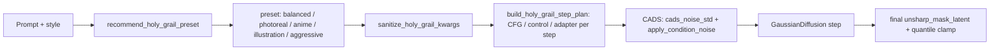
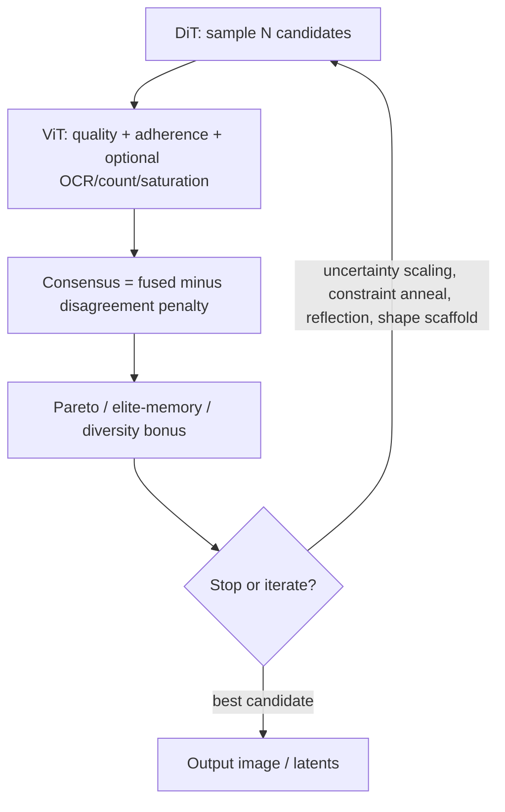

# How Our Model Generates an Image

This doc walks through the pipeline from **prompt → image** at inference (e.g. `sample.py`). Training learns the same forward pass in reverse (denoising).

**Visual pipeline:** Mermaid + ASCII diagram in §1; prose walkthrough from §2.

---

## 1. Pipeline diagram (Mermaid and ASCII)

## Pipeline overview (Mermaid)

```mermaid
flowchart TB
    subgraph inputs["Inputs"]
        P["Prompt"]
        N["Negative prompt"]
        S["Style (optional)"]
        C["Control image (optional)"]
        I["Init image / mask (optional)"]
        L["LoRA weights (optional)"]
    end

    subgraph load["Load from checkpoint & config"]
        CKPT["Checkpoint (.pt)"]
        CFG["Config (model_name, text_encoder, vae_model, image_size, ...)"]
        CKPT --> CFG
        CFG --> DIT["DiT (transformer)"]
        CFG --> T5["T5 tokenizer + encoder"]
        CFG --> VAE["VAE (decoder)"]
    end

    subgraph text["Text encoding"]
        P --> T5
        N --> T5
        S --> T5
        T5 --> COND["Conditioning embeddings (cond + uncond)"]
    end

    L -.->|"apply to weights"| DIT

    subgraph init["Initial latent"]
        NOISE["Random noise (B,4,H,W)"]
        IMG2IMG["Img2img: VAE encode init → add noise to t_start"]
        INPAINT["Inpainting: mask blend noise + image"]
        NOISE --> XINIT["x_init"]
        IMG2IMG --> XINIT
        INPAINT --> XINIT
    end

    I -.-> IMG2IMG
    I -.-> INPAINT
    C --> DIT

    subgraph diffusion["GaussianDiffusion"]
        CREATE["create_diffusion(timestep_respacing, num_timesteps, beta_schedule, prediction_type)"]
    end

    subgraph loop["Sampling loop (N steps)"]
        direction TB
        STEP["For each timestep t (high → low noise):"]
        DIT_COND["DiT(x, t, cond_emb)"]
        DIT_UNCOND["DiT(x, t, uncond_emb)"]
        CFG_COMBINE["CFG: pred = uncond + cfg_scale × (cond − uncond)"]
        RESCALE["Optional: CFG rescale / dynamic threshold"]
        DDIM["DDIM step: predicted x₀ → next x"]
        STEP --> DIT_COND --> DIT_UNCOND --> CFG_COMBINE --> RESCALE --> DDIM
        DDIM --> STEP
        COND --> DIT_COND
        COND --> DIT_UNCOND
        XINIT --> loop
    end

    loop --> X0["Clean latent x₀ (B,4,h,w)"]

    subgraph decode["Decode to image"]
        SCALE["x₀ / latent_scale"]
        VAE_DEC["VAE.decode(x₀)"]
        TO_RGB["(×0.5+0.5), clamp, HWC"]
        SCALE --> VAE_DEC --> TO_RGB
        X0 --> SCALE
        VAE --> VAE_DEC
    end

    subgraph post["Post-process & save"]
        RESIZE["Fit to --width / --height (patch rounding or capped canvas)"]
        SHARP["Optional: sharpen, contrast"]
        SAVE["Save PNG (and optional grid)"]
        TO_RGB --> RESIZE --> SHARP --> SAVE
    end

    style inputs fill:#e8f4e8
    style load fill:#e8e8f4
    style text fill:#f4e8e8
    style loop fill:#f4f4e8
    style decode fill:#e8f4f4
    style post fill:#f0e8f4
```

---

## Simplified linear flow

```
┌─────────────────────────────────────────────────────────────────────────────┐
│  PROMPT + NEGATIVE (+ style, control path, init/mask)                        │
└─────────────────────────────────────────────────────────────────────────────┘
                                      │
                                      ▼
┌─────────────────────────────────────────────────────────────────────────────┐
│  T5 ENCODER  (tokenize → encoder_hidden_states)                              │
│  → cond_emb (positive), uncond_emb (negative); optional style_emb           │
└─────────────────────────────────────────────────────────────────────────────┘
                                      │
                                      ▼
┌─────────────────────────────────────────────────────────────────────────────┐
│  INITIAL LATENT  (noise, or img2img/inpainting from init image + VAE/mask)   │
└─────────────────────────────────────────────────────────────────────────────┘
                                      │
                                      ▼
┌─────────────────────────────────────────────────────────────────────────────┐
│  DIFFUSION LOOP  (GaussianDiffusion.sample_loop)                             │
│  • Each step: DiT(x, t, cond) and DiT(x, t, uncond)                          │
│  • CFG: pred = uncond + cfg_scale × (cond − uncond)                          │
│  • Optional: CFG rescale, dynamic threshold on x₀                            │
│  • DDIM step → next x; repeat until t = 0                                    │
│  • Output: clean latent x₀                                                   │
└─────────────────────────────────────────────────────────────────────────────┘
                                      │
                                      ▼
┌─────────────────────────────────────────────────────────────────────────────┐
│  VAE DECODE  (x₀ / latent_scale → vae.decode → image in [-1,1])              │
└─────────────────────────────────────────────────────────────────────────────┘
                                      │
                                      ▼
┌─────────────────────────────────────────────────────────────────────────────┐
│  POST-PROCESS  (→ [0,1], resize, optional sharpen/contrast) → PNG (+ grid)   │
└─────────────────────────────────────────────────────────────────────────────┘
```

---

## Components and where they live

| Step | Component | Code / config |
|------|-----------|----------------|
| Load | Checkpoint, config | `sample.py`: `load_model_from_ckpt`; `ckpt["config"]`, `ckpt["ema"]` |
| Load | DiT | `models/` (e.g. `dit_text.py`); `get_dit_build_kwargs(cfg)` |
| Load | T5 | `cfg.text_encoder` → `AutoTokenizer`, `T5EncoderModel` |
| Load | VAE | `cfg.vae_model` → `AutoencoderKL` |
| Optional | LoRA | `models/lora.py`: `apply_loras(model, lora_specs)` |
| Encode | Text | `encode_text([prompt], tokenizer, text_encoder, device)` → (1, L, 4096) |
| Loop | Diffusion | `diffusion/gaussian_diffusion.py`: `create_diffusion`, `sample_loop` |
| Loop | DiT forward | `model(x, t, encoder_hidden_states=..., ...)` → noise or v prediction |
| Decode | VAE | `vae.decode(x0).sample` |
| Post | Quality | `utils/quality/finishing.py`: `sharpen`, `contrast` |

---

## Optional paths (same pipeline)

- **Img2img:** Init image → VAE encode → add noise to `t_start = strength × T` → run loop from that `x_init`.
- **Inpainting:** Init image + mask → encode, blend (noise in mask, noisy image outside) → run loop.
- **ControlNet:** Control image loaded and passed as `control_image`; DiT adds it to patch embeddings (see `models/conditioning.py`).
- **Style / creativity:** Extra keys in `model_kwargs_cond`; DiT uses them in the conditioning path.

The sections below continue with the same pipeline in prose and code pointers.

---

## 2. High-level flow

```
Prompt (+ optional negative, style, control)
    → Text encoder (T5) → embeddings
    → Diffusion loop: start from noise → DiT denoises step-by-step → clean latent
    → VAE decode → pixel image
    → Optional post (sharpen, contrast, resize) → save PNG
```

- **Latent space:** We never diffuse pixels. We diffuse **VAE latents** (e.g. 4×32×32 for 256×256). The DiT sees and predicts in this space; the VAE turns the final latent into an image. The latent grid follows `--width`/`--height` (any aspect ratio, whole patches; see `diffusion.sampling.sampling_canvas_hw`).
- **Denoising:** The model was trained to predict **noise** (or **velocity**, if `prediction_type="v"`) given noisy latent + timestep + text. At inference we run that many times, step by step, from high noise down to zero.

---

## 3. Load checkpoint and encoders

- **Checkpoint:** Contains `config` (TrainConfig) and `ema` or `model` state. From `config` we know `model_name`, `text_encoder`, `vae_model`, `image_size`, etc.
- **DiT:** Built with `get_dit_build_kwargs(cfg)` and loaded with the checkpoint state. It’s a **transformer** that takes noisy latent patches + timestep + text and outputs a prediction (noise or v).
- **T5:** Tokenizer + `T5EncoderModel` (e.g. T5-XXL). Encodes the prompt (and negative prompt) to fixed-size embeddings `(1, seq_len, 4096)`.
- **VAE:** `AutoencoderKL` (e.g. SD VAE). Used only at the end: **decode** the final latent → RGB image. Latents are scaled by `latent_scale` (e.g. 0.18215) before decode.

---

## 4. Encode text

- **Positive prompt** → tokenize (e.g. max_length=300) → T5 encoder → `cond_emb` shape `(1, L, 4096)`.
- **Negative prompt** (or default like “blurry, worst quality, bad anatomy…”) → same pipeline → `uncond_emb`.
- Optional **style** prompt → encoded and blended into conditioning (if `style_embed_dim` and `--style` are used).
- Optional **creativity** scalar 0–1 is added as extra conditioning if the model was trained with `creativity_embed_dim`. **`--creativity-jitter`** adds per-image noise (useful with **`--num`** > 1 for more spread).
- Optional **`--originality`** (0–1) prepends random **composition / lighting** tokens after subject tags ([`utils/prompt/art_direction.py`](../utils/prompt/art_direction.py)); train with **`--train-originality-prob`** for the same distribution at learning time.

These embeddings are passed as `encoder_hidden_states` (and negative as `encoder_hidden_states_negative` for CFG).

- Optional **`token_weights`** (per T5 position): `sample.py` parses `(word)` / `[word]` in the positive prompt, strips brackets for T5, and scales cross-attn conditioning (1.2 / 0.8). Training can mirror this with **`train.py --train-prompt-emphasis`** ([`utils/prompt/text.py`](../utils/prompt/text.py), [TRAINING_TEXT_TO_PIXELS.md](GUIDES.md)).

**Preview without a GPU:** `python -m scripts.tools preview_generation_prompt --prompt "..."` runs `utils.prompt.content_controls` + the same pos/neg token conflict filter as `sample.py` (subset of flags; no checkpoint). Set `SDX_DEBUG=1` to print a traceback if `apply_content_controls` fails.

---

## 5. Diffusion object

- **GaussianDiffusion** is created with the same `num_timesteps`, `beta_schedule`, and `prediction_type` as in training (e.g. 1000 steps, linear, epsilon).
- It knows how to:
  - **Add noise:** `q_sample(x0, t)` → `x_t` (forward diffusion).
  - **One denoise step:** `p_step(model, x_t, t, model_kwargs)` (DDPM); the loop steps with the solvers in `diffusion/solvers/` (DDIM: `_ddim_step`).
  - **Predict x0 from model output:** `_predict_x0_and_noise(model_out, x_t, t)` so we can compute the next `x_{t-1}` (or next DDIM state).

---

## 6. Sampling loop (denoising)

- **Initial latent:**
  - **Text-to-image:** `x = randn(1, 4, H_latent, W_latent)` (pure noise).
  - **Img2img / from-z:** Start from a latent (or from an image encoded with the VAE), add noise up to a timestep `t_start`, then denoise from there.
- **Timesteps:** For 50 steps we don’t use all 1000; we **subsample** (e.g. every 20th step) from 999 down to 0. So we get 50 steps: high noise → low noise → clean.
- **Per step:**
  1. **CFG (Classifier-Free Guidance):**  
     - Run the DiT **twice**: once with `encoder_hidden_states = cond_emb` (prompt), once with `uncond_emb` (negative).  
     - Prediction = `uncond + cfg_scale * (cond - uncond)`. Typical `cfg_scale=7.5` pushes the sample toward the prompt and away from the negative.
  2. **DDIM step:** Using the combined prediction, compute predicted `x_0` and then the next latent `x_{t_next}` (deterministic if `eta=0`).
  3. Replace `x` with that next latent and repeat.

- Loop ends when we’ve reached the last timestep. The result is **x_0**: the predicted clean latent (no noise).

---

## 7. What the DiT does each step

For each call `model(x, t, encoder_hidden_states=..., ...)`:

1. **Patchify:** `x` is latent `(B, 4, H, W)` with any `H`, `W` divisible by the patch. It’s split into patches (e.g. 2×2) and linearly embedded → sequence of tokens plus 2D sin/cos position encoding (the stored table at the native grid, PixArt-α interpolated positions elsewhere; axial 2D RoPE instead with `use_rope`).
2. **Timestep:** `t` is embedded (e.g. MLP + sin/cos) → `t_emb`.
3. **Text:** `encoder_hidden_states` (B, L, 4096) is projected to the model’s hidden size (e.g. 1152) via `text_embedder` → `text_emb`. If a negative prompt is used for CFG, that’s handled in `sample_loop` by two separate forward passes; inside the DiT we only see one conditioning at a time.
4. **Blocks:** A stack of transformer blocks. Each block:
   - **Self-attention** over the spatial tokens. If `num_ar_blocks` > 0, a **block-causal mask** is applied so that patches only attend to earlier blocks (and earlier positions within their block) in raster order; see §10 and [AR.md](MODEL_STACK.md#block-wise-autoregressive-ar-generation).
   - **Cross-attention:** query = spatial tokens, key/value = `text_emb` → the image tokens “look at” the text.
   - **MLP** and residual connections, with **AdaLN** (timestep `t_emb` modulates scale/shift).
5. **Final layer:** Projects the sequence back to patch-sized predictions (same shape as input patches), then **unpatchify** → `(B, 4, H, W)` or `(B, 8, H, W)` if `learn_sigma`. That output is the predicted **noise** (or **v**), which the diffusion code converts to a predicted `x_0` and then to the next `x`.

So at every step the DiT is answering: “Given this noisy latent, this timestep, and this text, what is the noise (or v)?” The diffusion loop uses that to move the latent toward a clean image that matches the prompt.

---

## 8. From latent to image

- **Unscale:** `x_0 = x_0 / latent_scale` (e.g. 0.18215).
- **VAE decode:** `image = vae.decode(x_0).sample` → `(1, 3, H_img, W_img)` in [-1, 1].
- **To uint8:** `(image * 0.5 + 0.5).clamp(0, 1)` → permute to HWC → multiply by 255, round, uint8.
- Optional: fit to `--width`/`--height` (only patch rounding or a capped canvas differs), then **sharpen** and **contrast** (e.g. `utils/quality`) and save as PNG.

---

## 9. Optional paths (same pipeline, different start/cond)

- **Img2img:** Encode initial image with VAE → add noise up to `t_start` → run the same loop from that `x_init` and `start_timestep`.
- **Inpainting:** Same as img2img but the initial noisy latent is a blend of (noise in mask region, noisy image in unmasked).
- **ControlNet:** A control image (depth/edge/pose) is encoded and **added** to the DiT’s patch embeddings inside the model; the rest of the loop is unchanged.
- **LoRA:** Applied on top of the loaded weights before sampling; the forward pass is the same.
- **Style / creativity:** Extra conditioning inputs to the DiT; the diffusion loop and VAE decode are unchanged.

---

## Summary

**Generation = iterative denoising in latent space, guided by text.**  
The DiT predicts noise (or v) from (noisy latent, timestep, text); the diffusion loop uses that prediction and the schedule to go from random noise to a clean latent; the VAE decodes that to the final image.

---

## 10. Where AR (autoregressive) fits in

If the model was trained with **`num_ar_blocks` > 0**, then during **every** denoising step the DiT’s **self-attention** over the spatial patches is **block-causal**: the patch grid is split into blocks (e.g. 2×2 or 4×4), and each block can only attend to earlier blocks (and within its own block, in raster order). So “top-left” is generated first, then “top-right” (seeing top-left), then bottom-left, then bottom-right. **Cross-attention to the text stays bidirectional** — all patches can see all text tokens.

**Code:**

- **Mask:** `models/attention.py` → `create_block_causal_mask_2d(h, w, num_ar_blocks)`. Builds an (N, N) mask with `-inf` where attention is disabled.
- **DiT:** In `models/dit_text.py` (all DiT-Text / P / Supreme models), when `num_ar_blocks > 0` the native grid's mask is registered as `self._ar_mask = create_block_causal_mask_2d(p, p, num_ar_blocks)`; `grid_ar_mask(model, h, w)` returns it, or builds (and caches) the same block order for any other patch grid. That mask is passed as `attn_mask` into every block’s self-attention.
- **SelfAttention** in `models/attention.py` takes that mask and uses it in `memory_efficient_attention(..., attn_mask=attn_mask)` or SDPA so that causal positions get `-inf` and are ignored.

So AR does **not** change the diffusion loop or text encoding; it only restricts **which spatial positions can see which** inside the DiT at each step. Full details: [docs/MODEL_STACK.md](MODEL_STACK.md#block-wise-autoregressive-ar-generation).

---

## 11. Code from the repos (external/)

**SDX does not import from `external/` at runtime.** All runnable code lives in the project (e.g. `models/`, `diffusion/`, `config/`). The repos in `external/` are **reference only** — we reimplement or adapt their ideas.

| Repo (clone into `external/`) | What we take from it (concepts / reference) |
|------------------------------|---------------------------------------------|
| **facebookresearch/DiT** | Patch embed, timestep embed, AdaLN blocks; diffusion respacing. Our [models/dit.py](../models/dit.py), [models/dit_text.py](../models/dit_text.py), [diffusion/gaussian_diffusion.py](../diffusion/gaussian_diffusion.py) are our own implementation. |
| **lllyasviel/ControlNet** | Structural conditioning (depth/edge/pose), control scale. Our [models/conditioning.py](../models/conditioning.py) and control path in the DiT are our own. |
| **black-forest-labs/flux** | Sampling loop, guidance, img2img/fill, structural conditioning docs. Our sampling is in [diffusion/gaussian_diffusion.py](../diffusion/gaussian_diffusion.py) and [sample.py](../sample.py). |
| **Stability-AI/generative-models** | SD3 / official stack as architecture and training reference. |

Clone them with `scripts/setup/clone_repos.ps1` (Windows) or `scripts/setup/clone_repos.sh` (Linux/macOS). For a file-level map of what in each repo corresponds to our features, see [docs/FILES.md](FILES.md) (section “Key files in external repos”). For a short list of ideas we use (PixAI, ComfyUI, etc.), see [docs/RESEARCH.md](RESEARCH.md#tools-repos-and-inspiration).

---

## 12. Ported code (no runtime dependency on external/)

The following are **adapted into our codebase** so they work with our config, training, and sampling. We do not import from `external/` at runtime.

| Our file | Ported from | What it does |
|----------|--------------|--------------|
| **diffusion/schedules.py** | DiT | `space_timesteps(num_timesteps, "ddim50" or "10,15,20")` for flexible inference timesteps. |
| **diffusion/gaussian_diffusion.py** | ControlNet | `norm_thresholding`, `spatial_norm_thresholding` for x0 dynamic thresholding. |
| **diffusion/schedules.py** | Min-SNR (Hang et al. 2023), EDM | `get_timestep_loss_weight(name, ..., prediction_type=)`: min_snr / min_snr_soft / edm / v / eps / unit, defined on the x0 error and converted to the eps/v/x0 target. |
| **models/dit_text.py** (`SizeEmbedder`) | PixArt-alpha/sigma | (h, w) size conditioning, enabled by `size_embed_dim > 0`. |

**Config / usage:** Respace: set `timestep_respacing="ddim50"` or `"10,15,20"`. Dynamic threshold: `sample_loop(..., dynamic_threshold_type="norm" or "spatial_norm", dynamic_threshold_value=1.0)` or `--dynamic-threshold-*` in sample.py. Loss weighting: `TrainConfig.loss_weighting="edm"` (or unit/v/eps) and `--loss-weighting` in train.py. SizeEmbedder: `--size-embed-dim` (lives in `models/dit_text.py`).

---

## 13. Config, checkpoints, and data wiring

---

### 1. Config flow

```
config/train_config.py (TrainConfig + get_dit_build_kwargs)
         │
         ├── train.py          (args → TrainConfig; saves cfg in checkpoint)
         ├── sample.py         (loads cfg from checkpoint)
         └── inference.py      (loads cfg from checkpoint)
```

- **Single source of truth:** `config/train_config.py` defines `TrainConfig` and `get_dit_build_kwargs(cfg, *, class_dropout_prob=None)`.
- **Training:** CLI args are converted to `TrainConfig`; the same object is saved in every checkpoint as `ckpt["config"]`.
- **Inference:** `sample.py` and `inference.py` load the checkpoint, read `cfg = ckpt["config"]`, and build the DiT with `model_fn(**get_dit_build_kwargs(cfg, class_dropout_prob=0.0))`. They also read `cfg.text_encoder`, `cfg.vae_model`, `cfg.image_size`, etc. for T5, VAE, and diffusion.
- **Why this matters:** Adding a new model option (e.g. `creativity_embed_dim`) only needs to be added in `TrainConfig` and in `get_dit_build_kwargs`; all entry points then stay in sync.

---

### 2. Model build (DiT)

All of these build the **same DiT** from the same checkpoint config:

| Entry point | How it builds DiT |
|-------------|-------------------|
| **train.py** | `model_fn(**get_dit_build_kwargs(cfg))` (uses `cfg.caption_dropout_prob`) |
| **sample.py** | `model_fn(**get_dit_build_kwargs(cfg, class_dropout_prob=0.0))` |
| **inference.py** | `model_fn(**get_dit_build_kwargs(cfg, class_dropout_prob=0.0))` |

`get_dit_build_kwargs` returns: `input_size`, `text_dim`, `class_dropout_prob`, `num_ar_blocks`, `use_xformers`, `style_embed_dim`, `control_cond_dim`, `creativity_embed_dim`, `size_embed_dim`.  
Model registry: `models/__init__.py` → `DiT_models_text`: `DiT-XL/2-Text` (base), `DiT-P/2-Text`, `DiT-P-L/2-Text` (predecessor), **`DiT-Supreme/2-Text`**, **`DiT-Supreme-L/2-Text`** (supreme: RMSNorm + QK-norm self+cross + SwiGLU + AdaLN-Zero + optional size embed).

---

### 3. Components used where

| Component | train.py | sample.py | inference.py |
|-----------|-----------|-----------|--------------|
| **TrainConfig / cfg** | Yes (from args) | From ckpt | From ckpt |
| **T5 (text encoder)** | Yes (encode captions) | Yes (encode prompt) | Yes |
| **VAE** | Yes (encode images → latents) | Yes (decode latents → image) | Yes |
| **DiT** | Yes (train) | Yes (sample) | Yes (refine/sample) |
| **diffusion** | Yes (training_losses) | Yes (sample_loop) | Yes |
| **caption_utils** | Via dataset | — | — |
| **ControlNet** | If control_cond_dim | If --control-image | — |
| **LoRA** | — | If --lora | — |
| **BLIP / VLM** | — | — | — |

T5 and VAE are always loaded from **cfg.text_encoder** and **cfg.vae_model** (Hugging Face IDs or local paths like `pretrained/T5-XXL`).

---

### 4. Data flow

**Training**

```
data_path or manifest_jsonl
    → Text2ImageDataset (data/t2i_dataset.py)
    → collate_t2i → batch { pixel_values, captions, negative_captions, styles, (difficulty), (control_image), (latent_values) }
    → train.py: encode_text(captions) → T5; optional --train-prompt-emphasis → cleaned captions + token_weights in model_kwargs
    → encode_images or latent_values → VAE or cache
    → diffusion.training_losses(model, latents, t, model_kwargs)
    → model(x_t, t, **model_kwargs)  [DiT forward]
```

**Sampling**

```
Checkpoint → cfg + DiT state
cfg.text_encoder, cfg.vae_model → T5, VAE (from HF or pretrained/)
Prompt → encode_text([prompt]) → cond_emb
model_kwargs_cond = { encoder_hidden_states: cond_emb, (style), (control_image), (creativity) }
diffusion.sample_loop(model, shape, model_kwargs_cond, model_kwargs_uncond, ...)
    → x0 (latents)
VAE.decode(x0 / latent_scale) → image
```

**Self-improvement**

```
Checkpoint → cfg + DiT; T5, VAE, diffusion (same as sample)
For each prompt: sample_loop → x0 → decode → save image
Optional: BLIP captioner → overwrite caption in manifest
Write manifest.jsonl + images → use with train.py --manifest-jsonl
```

---

### 5. Where models live

| Model | Config key | Default | Can be local |
|-------|------------|---------|--------------|
| **T5** | `cfg.text_encoder` | `google/t5-v1_1-xxl` | Yes (e.g. `pretrained/T5-XXL`) |
| **VAE** | `cfg.vae_model` (+ `vae_subfolder`) | `REPA-E/e2e-flux-vae` (16-channel); channels / scale / shift read from its config | Yes (e.g. `stabilityai/sd-vae-ft-mse` for 4-channel SD latents) |
| **DiT** | Built from cfg; weights in checkpoint | — | Checkpoint only |
| **LLM** | Not in cfg | — | `pretrained/SmolLM2-360M-Instruct`, `pretrained/Qwen3-14B` (for prompt expansion; not used inside train/sample) |

Download T5 + VAE + LLMs: `python setup/download.py models --all` → `pretrained/`.

---

### 6. Scripts and what they plug into

| Script | Reads | Writes / uses |
|--------|-------|----------------|
| **train.py** | TrainConfig (args), data_path/manifest_jsonl, optional latent_cache_dir | Checkpoint (model, ema, config, steps), logs |
| **sample.py** | Checkpoint, prompt, optional style/control/creativity | Image, optional attn .pt |
| **inference.py** | Checkpoint | Programmatic API (refine, etc.) |
| **setup/download.py models** | — | pretrained/T5-XXL, pretrained/sd-vae-ft-mse, pretrained/sdxl-vae*, pretrained/SmolLM*, pretrained/Qwen* |
| **setup/download.py llm** | — | pretrained/SmolLM2-360M-Instruct or pretrained/Qwen3-14B |
| **python -m scripts.tools precompute_latents** | data_path, vae_model | latent_cache_dir/*.pt (per image) |
| **scripts/setup/clone_repos.ps1 / .sh** | — | external/ (reference repos) |
| **python -m scripts.tools ckpt_info** | checkpoint path | — (prints config) |
| **scripts/tools/dev/quick_test.py** | — | — (smoke test) |

---

### 7. Quick checklist: adding a new DiT option

1. Add the field to **TrainConfig** in `config/train_config.py`.
2. Add it to **get_dit_build_kwargs()** in the same file (with a getattr default).
3. Use it in the **DiT_Text constructor** in `models/dit_text.py` (DiT-P / Supreme inherit it).
4. Add CLI arg in **train.py** and pass into TrainConfig (if training-time only, that’s enough).
5. For inference: **sample.py** / **inference.py** already get it from checkpoint config via get_dit_build_kwargs; add any new CLI (e.g. `--creativity`) and pass into model_kwargs.

---

## Holy Grail adaptive sampling (how it fits together)

**Holy Grail** is SDX's name for a **per-step inference policy**: CFG strength, ControlNet scale and adapter scales change across denoise steps instead of staying fixed, with optional CADS condition annealing and a final latent detail pass.

The code is one module, [`diffusion/sampling.py`](../diffusion/sampling.py) (import path `diffusion.sampling`). `GaussianDiffusion.sample_loop` applies it each step; `sample.py` exposes it as `--holy-grail`, `--holy-grail-preset` and the `--holy-grail-*` knobs.

### End-to-end flow



### Design intent

| Idea | Role |
|------|------|
| **Presets + auto** | `--holy-grail-preset auto` picks a knob bundle from prompt keywords; a preset only fills args still at their defaults. |
| **Step plan** | CFG ramps from `cfg_early_ratio` to `cfg_late_ratio` of the base scale; ControlNet front-loads (or ramps up with `--holy-grail-no-frontload-control`); adapters boost late. |
| **CADS** | Gaussian noise on the text conditioning, strongest at the first step and decaying as `(1-p)^power`: more varied compositions at high CFG while late steps stay faithful (Sadat et al., ICLR 2024). |
| **Final latent pass** | `unsharp_mask_latent` (in `diffusion/gaussian_diffusion.py`) lifts fine detail; the quantile clamp clips per-sample outliers without rescaling. |
| **Guard** | Every knob is clamped to a stable range and made consistent before it reaches the loop. |

### CLI starter

```bash
python sample.py --ckpt path/to.pt --prompt "..." --holy-grail \
  --holy-grail-preset auto \
  --holy-grail-cads-strength 0.03 \
  --holy-grail-cfg-early-ratio 0.72 \
  --holy-grail-cfg-late-ratio 1.0 \
  --holy-grail-control-mult 1.1 \
  --holy-grail-unsharp-sigma 0.6 \
  --holy-grail-unsharp-amount 0.18 \
  --holy-grail-clamp-quantile 0.995
```

`--holy-grail-clamp-quantile` clips per-sample outliers of the final latent to that |x| quantile (at least `--holy-grail-clamp-floor`); it does not rescale the latent.

---

## Sampling guide (solvers & schedules)

SDX separates **when** to evaluate the model (schedules) from **how** to update
latents (solvers). The guidance stack (APG, FDG, CFG rescale, PAG, ...) and dynamic
thresholding compose with any of the combinations below.

### Recommended combos

| Goal | VP (classic DiT) | Flow-matching ckpt |
|------|------------------|--------------------|
| **Best quality** | `--scheduler ays_dit --solver dpmpp_2m --steps 28` | `--flow-matching-sample --flow-solver dpmpp_2m --flow-schedule ays --steps 20` |
| **More texture** | `--solver dpmpp_2m_sde --steps 30` (add `--refine restart`) | `--flow-solver dpmpp_2m_sde --sde-band 0.11,2.3` |
| **Fast** | `--scheduler ays_dit --solver unipc --steps 15` | `--flow-solver heun --flow-schedule karras --steps 12` |
| **Legacy** | `--scheduler ddim --solver ddim` | `--flow-solver euler --flow-schedule linear` |

Presets (`--preset sdxl|flux|anime|superior|fast`) soft-apply these defaults.
OP modes: `--op-mode quality` / `--op-mode fast`.

### VP solvers (`--solver`)

| Name | Notes |
|------|--------|
| `dpmpp_2m` | **Default.** DPM-Solver++(2M), data-prediction exponential integrator (Lu et al. 2022). |
| `dpmpp_2m_sde` | DPM-Solver++(2M) SDE: re-injects noise each step (`--eta`, default 1), which corrects accumulated ODE error and keeps fine texture. |
| `dpmpp_3m` | Third-order multistep; better at high NFE, can overshoot below ~12 steps. |
| `unipc` | UniPC-2 (Zhao et al. 2023): DPM++ predictor + UniC corrector, one forward per step; strong at 10–20 steps. |
| `heun` | EDM Heun on the noise-prediction ODE (2 forwards/step); needs a dense schedule (e.g. `karras_rho`). |
| `ddim` | DDIM; `--eta` > 0 gives DDPM-like ancestral noise. |
| `apex` / `apex_adaptive` | Embedded-error multistep (see `docs/RESEARCH.md`). |

Aliases such as `dpm++_2m`, `dpmsolver_pp_1`, `uni_pc` resolve to the real backends.

### Noise re-injection

- `--eta` applies to `ddim`, `heun` and `dpmpp_2m_sde` (VP) and `dpmpp_2m_sde` (flow).
  ODE solvers reject `--eta > 0` instead of ignoring it.
- `--sde-band LO,HI` injects noise only where the EDM noise level σ lies in `[LO, HI]`
  (VP σ = sqrt((1-ᾱ)/ᾱ), flow σ = s/(1-s)); `0.11,2.3` is flow s ∈ [0.1, 0.7], where texture forms.
- Frontier serendipity curves (`step_noise_scales`) multiply η per step and need a stochastic solver.

### Exposure-bias correction

`--eps-scale 1.003` (optionally with `--eps-scale-k`) divides the noise prediction by
λ_t = eps_scale + eps_scale_k·t at every evaluation (epsilon scaling, Ning et al., ICLR 2024).
Off by default; it costs no extra forwards.

### Refinement (`--refine`)

Off by default. `--refine restart` runs Restart sampling (Xu et al., NeurIPS 2023) on the
result: renoise to `--refine-t` (default 200), re-solve with the same sampler in
`--restart-steps` steps, `--restart-cycles` times (default 2). It works for VP and flow
checkpoints. `--refine-gate auto` skips it when a quick quality score is already high.

### VP schedules (`--scheduler`)

| Name | Notes |
|------|--------|
| `ays_dit` | **Default.** Align-Your-Steps style with denser mid-SNR for DiT/T5. |
| `ays` | Classic AYS-inspired log-SNR knots. |
| `karras_rho` | EDM (Karras et al. 2022) ρ-spacing in σ (`--karras-rho`, default 7). |
| `snr_uniform` / `quad_cosine` / `ddim` / `euler` | Older grids. |

### Flow solvers (`--flow-solver`)

| Name | Notes |
|------|--------|
| `dpmpp_2m` | **Default for flow.** DPM-Solver++(2M) with α = 1−s, σ = s; the first step is Euler. |
| `dpmpp_2m_sde` | Its SDE variant (`--eta`, `--sde-band`). |
| `heun` / `midpoint` | 2nd-order, 2 forwards/step; Heun takes an Euler last step to s = 0 (EDM). |
| `euler` | 1st-order baseline. |

### Flow schedules (`--flow-schedule`)

| Name | Notes |
|------|--------|
| `ays` | **Default.** AYS knots mapped onto continuous `s ∈ [1,0]`. |
| `ays_dit` | Extra mid-band samples. |
| `karras` | EDM ρ-spacing in σ = s/(1-s), σ_max capped at 80. |
| `linear` | Uniform `linspace(1→0)`. |

### Resolution, aspect ratio and the timestep shift

- **Canvas.** `--width/--height` set the latent grid, not a post-decode stretch. The requested size is
  snapped to whole DiT patches (16 px for patch 2) when its area is within 2× of the native square;
  otherwise sampling runs at the native pixel area with the requested aspect ratio and the last step
  (`--hires-fix`, else a resize) reaches the size. Without a size, img2img follows the init image's
  aspect ratio. The DiTs take any patch grid: positions use PixArt-α interpolated sin/cos (the stored
  table at the native grid, so old checkpoints are unchanged), `use_rope` is axial 2D RoPE, and
  block-AR masks are built per grid.
- **Shift.** Flow grids get the SD3 shift `s' = a·s / (1 + (a−1)·s)` (Esser et al. 2024, Eq. 23) with
  `a = --flow-shift · sqrt(tokens / native tokens)`; `--flow-shift` defaults to the checkpoint's
  `flow_shift`, else 1, so the native grid is unchanged. `diffusion.schedules` holds the helpers
  (`time_shift`, `sd3_resolution_shift`, `flux_resolution_shift`, `vp_shifted_timestep`) for training
  to reuse.
- **Hires-fix / dual-stage.** Both work for VP and flow. The upscaled latent is re-noised to
  `--hires-strength` (or `--dual-detail-strength`) shifted for its grid (flow `time_shift`, VP: the
  timestep whose log-SNR is lower by `2·log a`), then denoised with the run's solver settings.

### Dynamic thresholding

`--dynamic-threshold-percentile 99.5` is Imagen's dynamic thresholding of the x0 prediction
at every step: clip to s = max(percentile(|x0|), r) and rescale onto [−r, r], where r is
`--dynamic-threshold-value` (default 1, the pixel range). For VAE latents set r to the
latent range (e.g. 4); with r = 1 the latent is shrunk toward grey.

### Implementation

- Solvers: [`diffusion/solvers/`](../diffusion/solvers.py)
- Schedules: [`diffusion/solvers.py`](../diffusion/solvers.py)
- Loop wiring: [`diffusion/gaussian_diffusion.py`](../diffusion/gaussian_diffusion.py)
- Resolution shift: [`diffusion/schedules.py`](../diffusion/schedules.py); canvas: [`diffusion/sampling.py`](../diffusion/sampling.py)

```bash
python sample.py --ckpt ... --prompt "..." --scheduler ays_dit --solver dpmpp_2m --steps 28
python sample.py --ckpt ... --prompt "..." --solver dpmpp_2m_sde --refine restart
python sample.py --ckpt ... --prompt "..." --flow-matching-sample --flow-solver dpmpp_2m --flow-schedule ays
```

---

## TCIS — Tri-Consensus Iterative Synthesis


**TCIS (Tri-Consensus Iterative Synthesis)** is a **control layer** on top of SDX: DiT (and optional AR behavior from the checkpoint) **proposes** candidates; a **ViT quality head** **critiques** them; the stack **ranks** with disagreement-aware scoring and can **iterate** with stricter guidance or prompt updates.

It does **not** replace DiT or `vit_quality` training; it orchestrates them for hard prompts and test-time scaling.

### Closed-loop flow



### Consensus sketch

For each candidate, SDX uses a **disagreement penalty** so "pretty but wrong prompt" does not automatically win:

- `fused = wq * quality + wa * adherence`
- `consensus = fused - lambda * abs(quality - adherence)`

Exact weights and extra metrics are CLI flags on the hybrid tool.

### Where to run it

```bash
python -m scripts.tools hybrid_dit_vit_generate --help
```

Shape / scaffold helpers: `utils/prompt/scene.py`.

---

### Architecture, flags, and usage
 Tri-Consensus Iterative Synthesis

TCIS is a new model-design layer built on top of the existing SDX stack.  
It is not a replacement for DiT or ViT; it is a control architecture that combines them into a closed-loop generator.

### Why this is different

Most pipelines do one of these:

- generate once and return,
- generate many then rank once.

TCIS does:

1. **Propose**: DiT (with AR behavior from checkpoint) generates multiple candidates.
2. **Critique**: ViT predicts quality and prompt-adherence per candidate.
3. **Consensus**: rank by a disagreement-aware score, not just raw quality.
4. **Self-correct**: if adherence is weak, inject strict guidance and run another round.
5. **Select globally**: choose the best candidate across all iterations.

### Consensus objective

For each candidate:

- `fused = wq * quality + wa * adherence`
- `consensus = fused - lambda * abs(quality - adherence)`

The penalty term prefers candidates where both heads agree, reducing fragile "looks good but wrong prompt" outcomes.

### Where it is implemented

- `scripts/tools/generate.py`
  - `--iterations`
  - `--vit-disagreement-penalty`
  - `--consensus-ocr-weight`
  - `--consensus-count-weight`
  - `--consensus-saturation-weight`
  - `--pareto-elite`
  - `--pareto-topk`
  - `--adaptive-num` / `--adaptive-threshold` / `--adaptive-max-num`
  - `--constraint-anneal`
  - `--uncertainty-threshold` / `--uncertainty-extra-iterations` / `--uncertainty-max-iterations`
  - `--elite-memory-size` / `--diversity-bonus-weight`
  - `--reflection-update`
  - `--self-correct-prompt`
  - `--self-correct-threshold`
  - `--auto-shape-scaffold`
  - `--shape-scaffold-strength`
  - `--shape-max-actors`
- `utils/prompt/scene.py`
  - prompt -> shape-first scene blueprint synthesis
  - compiles blueprint into positive/negative controls

### Quick usage

```bash
python -m scripts.tools hybrid_dit_vit_generate \
  --ckpt results/run/best.pt \
  --vit-ckpt vq/runs/best.pt \
  --prompt "hero character, full body, cinematic rain, readable title text" \
  --out outputs/tcis.png \
  --num 8 \
  --iterations 3 \
  --auto-shape-scaffold \
  --pareto-elite \
  --adaptive-num \
  --reflection-update \
  --self-correct-prompt \
  --pick-best combo_hq
```

### Expected gains

- Better prompt faithfulness on hard prompts.
- More stable quality under seed variation.
- Cleaner "best of N" decisions due to disagreement-aware ranking.
- Improved constraint handling via OCR/count/saturation-aware consensus.
- More robust elite selection with Pareto-front filtering.
- Better failure recovery via uncertainty-triggered test-time scaling.
- Less mode collapse in iterative loops through elite-memory diversity bonuses.

### Next upgrades

- Add branch-level prompt search (2-3 prompt branches per iteration with budget cap).
- Add richer diversity embeddings (CLIP-image novelty instead of color-signature novelty).
- Distill TCIS choices into a train-time preference set for DPO.

---

## Agentic Stack

Autonomous **plan → tool → verify → reflect → evolve** layer for SDX image generation.

Built on research from GenEvolve, VisionCreator (UTPC), and VisionCreator-R1 (Act–Reflect–Think–Act).

### Architecture

```
User prompt
    │
    ▼
┌─────────┐   UTPC plan (utils/agentic/agent.py)
│ Planner │── rag → expand → generate → verify → reflect
└─────────┘
    │
    ▼
┌─────────┐   sample.py + Superior Stack flags
│  Tools  │── composite rank, self-correct, flywheel, benchmark
└─────────┘
    │
    ▼
┌──────────┐   best–worst trajectory diff
│ Experience│── prompt patches → experience_memory.jsonl
└──────────┘
```

### Modules (`utils/agentic/`)

Generation orchestration agents (plan → tool → verify → reflect). Import via `utils.agentic`.

| Module | Role |
|--------|------|
| `agent.py` | `ImageGenerationAgent` — main loop |
| `tools.py` | Tool registry (RAG, generate, verify, flywheel, …) |
| `planner.py` | UTPC plan builder |
| `reflector.py` | Act–Reflect–Think–Act verdicts |
| `experience.py` | GenEvolve-style trajectory distillation |
| `roles.py` | Designer / Verifier / Reasoner single-pass pipeline |
| `state.py` | Traces + trajectory records |

### CLI

```bash
# Single agentic run (reflect loop)
python -m scripts.tools agentic_generate \
  --ckpt results/best.pt \
  --prompt "portrait of a scientist, studio lighting" \
  --local-rag-jsonl datasets/facts.jsonl \
  --vit-ckpt results/vit/best.pt \
  --out out.png

# Multi-trajectory evolve + experience memory
python -m scripts.tools agentic_evolve \
  --ckpt results/best.pt \
  --prompt "neon alley at night" \
  --variants 3 --work-dir evolve_run

# Full agentic flywheel (evolve → benchmark → align)
python -m scripts.tools agentic_flywheel \
  --base-ckpt results/best.pt \
  --prompt "your test prompt" \
  --local-rag-jsonl datasets/facts.jsonl

# Explicit multi-role pass (no reflect loop)
python -m scripts.tools agentic_roles \
  --ckpt results/best.pt \
  --prompt "mountain lake at dawn" \
  --out roles_out.png
```

PowerShell one-click:

```powershell
python -m scripts.tools agentic generate --ckpt results\best.pt --prompt "neon alley"
python -m scripts.tools agentic evolve --ckpt results\best.pt --prompt "..." --variants 3
```

### Traces

Each run writes `agent_trace.json` under `--work-dir` with trajectories, reflections, and patches.

Experience memory appends to `experience_memory.jsonl` for cross-session learning.

### Relation to Superior Stack

- **Superior Stack** (`utils/agentic/quality_loop.py`) = tools and quality modules
- **Agentic Stack** (`utils/agentic/`) = autonomous orchestration over those tools

### Honest scope

This is a **real, local agent loop** — not a frontier MLLM agent. Planning and reflection are heuristic (optionally LLM via `--expand-prompt` / Qwen when configured). Value: structured trajectories, automatic retries, and experience memory without manual CLI chaining.

---

## Visual Brain — Understand, Edit, Generate

The **Visual Brain** is SDX's orchestration layer for **understanding** reference images and **iteratively generating/editing** until the output matches the user's prompt.

### Pipeline

```
User prompt
    ↓
[Web search] ──→ download reference images (optional)
    ↓
[Understand] ──→ OCR (pytesseract) + VLM caption (Moondream2) + canny control maps
    ↓
[Dissect] ──→ parse "use X from image N"; GDINO+SAM2 crops/masks when available
    ↓
[Scene brief] ──→ merge user intent + facts (never drop original prompt)
    ↓
[Generate] ──→ sample.py (creative RAG, dissection init, ControlNet, Superior stack)
    ↓
[Verify] ──→ composite + CLIP + OCR (if expected text)
    ↓
[Edit loop] ──→ OCR-fix / inpaint until coverage threshold
```

### Quick start

```bash
# Full brain: web search + understand + generate + edit
python -m scripts.tools visual_brain \
  --ckpt results/best.pt \
  --prompt "neon diner sign reading OPEN at night, vintage cars" \
  --expected-text OPEN \
  --web-search \
  --out diner.png

# With local references (dissection + inpaint init)
python -m scripts.tools visual_brain \
  --ckpt results/best.pt \
  --prompt "use the hat from image 1, portrait of a woman" \
  --reference-images ref_hat.png,ref_face.png \
  --out portrait.png

# Dry-run (build scene brief only, no GPU sampling)
python -m scripts.tools visual_brain \
  --ckpt results/best.pt \
  --prompt "test" \
  --dry-run
```

### Modules

| Module | Role |
|--------|------|
| `utils/captioning.py` | DuckDuckGo + Wikimedia image search |
| `utils/captioning.py` | OCR, VLM caption, control map extraction |
| `utils/agentic/agent.py` | Synthesized plan of final image contents |
| `utils/agentic/agent.py` | Main orchestrator |
| `utils/agentic/agent.py` | Agent tools: `web_search`, `understand_refs`, `dissect_refs`, … |
| `utils/agentic/agent.py` | `plan_visual_brain()` DAG |

### Agent integration

```bash
python -m scripts.tools visual_brain --use-agent \
  --ckpt results/best.pt \
  --prompt "..." \
  --reference-images a.png \
  --web-search
```

Or extend the agentic stack with `ImageGenerationAgent.run_visual_brain(ctx)`.

### Optional models (under `pretrained/`)

- **Moondream2** — VLM captions (`--creative-rag`)
- **GroundingDINO + SAM2** — dissection / segmentation masks
- **Qwen** — LLM reflector in agent loop (`--qwen-path`)
- **pytesseract** — OCR read + verify

Without these, the brain degrades gracefully: heuristics + facts-only dissection + CLIP verify.

### Outputs

Each run writes to `--work-dir`:

- `scene_brief.json` — what the brain decided must appear
- `brain_trace.json` — step log (search, understand, metrics per loop)
- `search/` — downloaded reference images
- `dissection/` — crops and masks
- Final image at `--out`

---

## Editing phase (post-generation refine loop)

Implements the flowchart:

**prompts + text encoders + model/VAE/size → sampler → image → break into pieces → editing phase → (prompt gaps / RAG / text fix / art rules) → loop until cohesive & non-AI-looking.**

### Quick start

```bash
# Plan-only (masks, diagnosis, art post) — no checkpoint required
python -m scripts.tools generate editing-phase \
  --image outputs/sample.png \
  --prompt 'a samurai at sunset, sign says "OPEN"' \
  --dry-run --out-dir outputs/edit_demo

# Full loop (img2img / inpaint via sample.py)
python -m scripts.tools generate editing-phase \
  --image outputs/sample.png \
  --prompt "..." \
  --ckpt results/best.pt \
  --scheduler ays_dit --solver dpmpp_2m \
  --out-dir outputs/edit_demo
```

### What it does each iteration

1. **Diagnose** — sharpness / exposure / CLIP gates; expected quoted text; anatomy cues; missing prompt tokens (vs optional caption)
2. **Break into pieces** — REVE-style region masks (`face`, `hands`, `clothing`, `subject`, `background`) under `pieces/`
3. **Plan** — OCR fix, piece inpaint, prompt realign, RAG prompt delta, artistic post
4. **Apply** — `sample_edit_runner` (DPM++ / AYS defaults) or dry-run
5. **Stop** when gates pass or `max_iters`

### Code

| Piece | Path |
|-------|------|
| Orchestrator | [`utils/generation/editing.py`](../utils/generation/editing.py) |
| CLI | [`scripts/tools/generate.py`](../scripts/tools/generate.py) |
| Edit backend | [`utils/generation/sample_argv.py`](../utils/generation/sample_argv.py) |

Pairs with modern sampling defaults in [SAMPLING.md](#sampling-guide-solvers--schedules).

---

## Integration Guide

Current integration points for multi-sample quality tooling and spatial layout control.

### Batch / quality tooling

Batch-effect prototype APIs under `utils.inference` were removed. For multi-sample quality:

- `python -m scripts.tools superior_generate` / pick-best via Superior Stack
- `python -m scripts.tools image_quality_qc`
- See [SUPERIOR_STACK.md](QUALITY.md#superior-stack) and [QUALITY.md](QUALITY.md)

### Spatial layout

Region-level composition goes through `sample.py --box-layout layout.json`
(`utils/generation/regional.py`): each region carries a normalized box and its own prompt,
applied as regional CFG during sampling. See `examples/box_layout.example.json` and
`examples/box_layout_sketch.example.json`.
